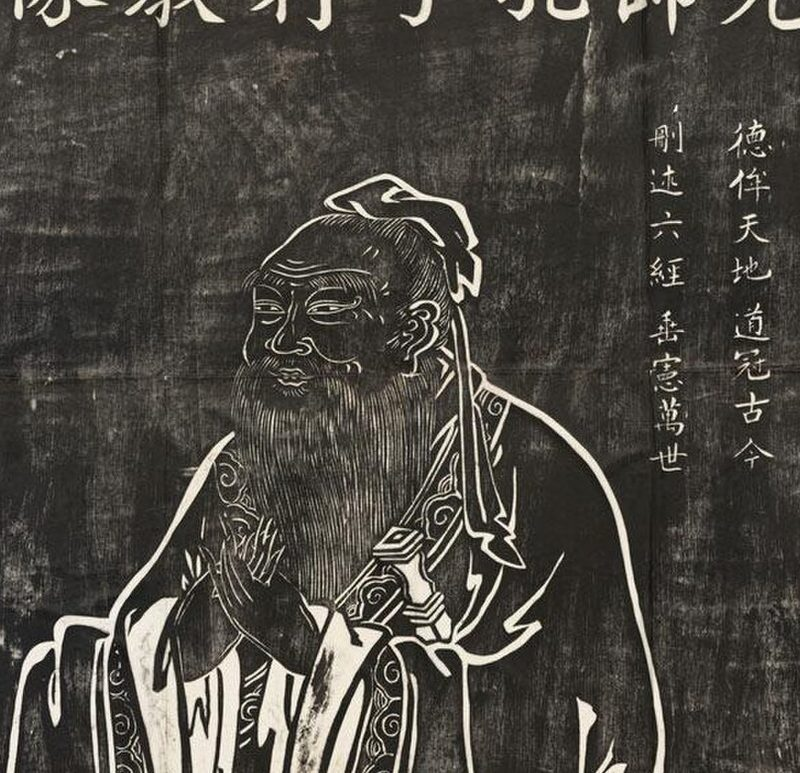
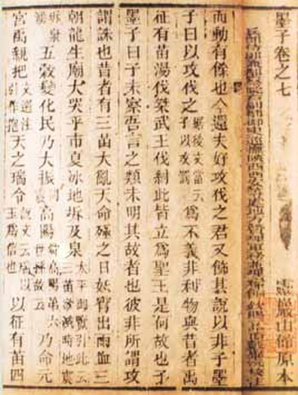
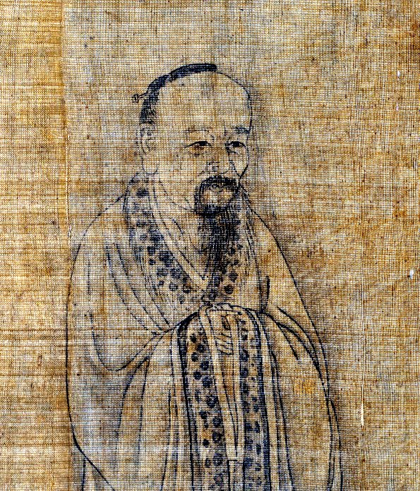
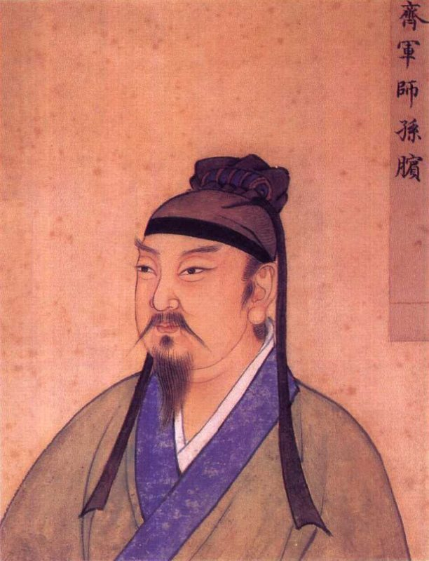
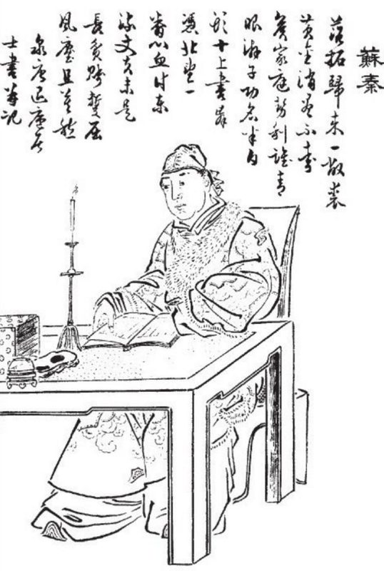
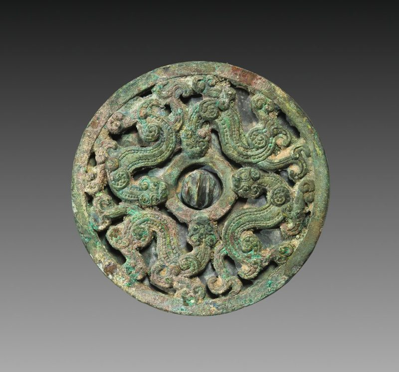
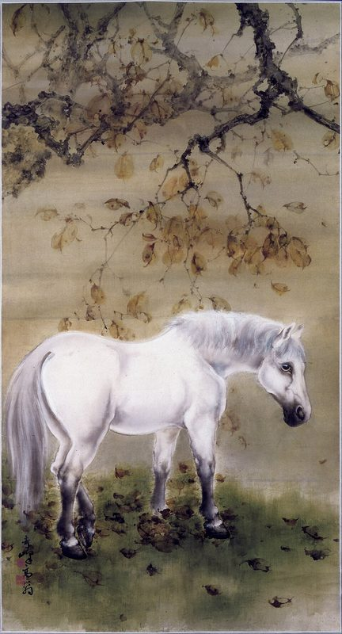
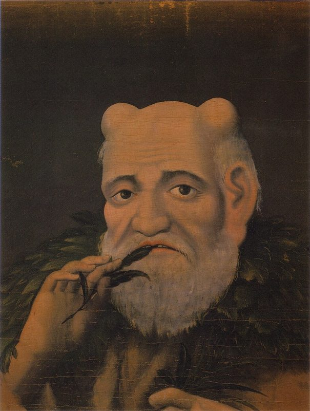
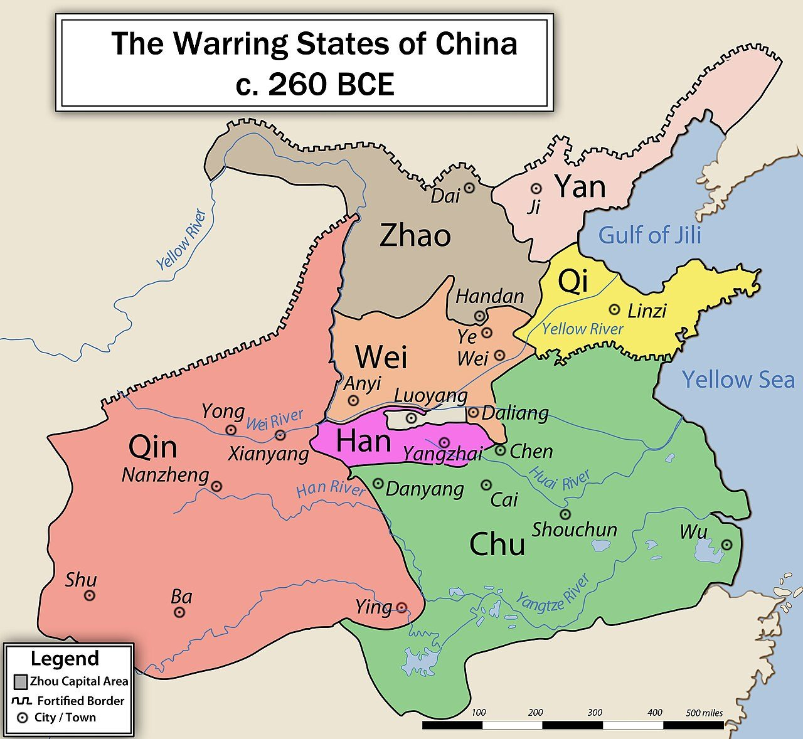

## One slide, many looks {#many-looks}

:::: {.columns}
::: {.column width="52%"}
- Write the words **once**, in English and 中文: `[Schools | 诸子]{.bi}`
- Put `{.styled kind="cards"}` on the heading to pick a layout: **cards**, **narrative** or **big idea**
- Click any card or paragraph on the next slides to highlight it
:::
::: {.column width="48%"}
::: {.callout-tip title="Try it" icon=false}
On the next slides, look at the top-right corner. **EN · 文A · 中** picks the languages; **⇅** swaps which one is large. In the teacher site, **Style…** opens the colours, look and layout.
:::
:::
::::

::: notes
This deck is an experiment. The language switch in the corner is in both sites and is remembered in this browser. The Style… panel (teacher site only) is for trying looks: its changes stay in this browser, and Copy settings puts the heading's attributes on the clipboard to paste into the file. Colour schemes beyond the five built-in ones (Bamboo and Scroll here) are written in the teacher's own CSS file next to this deck, `slide-style-teacher.css`.
:::

## [Warring States thinkers · schools of thought | 战国诸子 · 诸子百家]{.bi} {#schools-of-thought .styled kind="cards" type="row" look="game" scheme="brand" items="5" img="banner"}

::: schools

::: card
{.pic credit="After Wu Daozi, stone rubbing, public domain"}

[Confucianism | 儒家]{.bi .name}

[Mencius | 孟子]{.bi .who}

[Benevolent government | 仁政]{.bi .idea}

[Mencius | 《孟子》]{.bi .text}
:::

::: card
{.pic credit="Mozi, old woodblock edition, public domain"}

[Mohism | 墨家]{.bi .name}

[Mozi | 墨子]{.bi .who}

[Universal love, no aggressive war | 兼爱非攻]{.bi .idea}

[Mozi | 《墨子》]{.bi .text}
:::

::: card
{.pic credit="Album painting, public domain"}

[Daoism | 道家]{.bi .name}

[Zhuangzi | 庄子]{.bi .who}

[Follow nature | 顺应自然]{.bi .idea}

[Zhuangzi | 《庄子》]{.bi .text}
:::

::: {.card .spot}
{.pic credit="Sabinowitz, CC BY-SA 4.0"}

[Legalism | 法家]{.bi .name}

[Han Fei | 韩非]{.bi .who}

[Rule by law, strong central ruler | 以法治国]{.bi .idea}

[Han Feizi | 《韩非子》]{.bi .text}
:::

::: card
{.pic credit="Ming painting, public domain"}

[Military thinkers | 兵家]{.bi .name}

[Wu Qi, Sun Bin | 吴起 孙膑]{.bi .who}

[Military strategy | 军事战略]{.bi .idea}

[Sun Bin's Art of War | 《孙膑兵法》]{.bi .text}
:::

::: card
{.pic credit="Woodcut, public domain"}

[Diplomats | 纵横家]{.bi .name}

[Su Qin, Zhang Yi | 苏秦 张仪]{.bi .who}

[Alliances and diplomacy | 合纵连横]{.bi .idea}

[Strategies of the Warring States | 《战国策》]{.bi .text}
:::

::: card
{.pic credit="Cleveland Museum of Art, CC0"}

[Yin-Yang school | 阴阳家]{.bi .name}

[Zou Yan | 邹衍]{.bi .who}

[Yin, yang and five phases | 阴阳五行]{.bi .idea}

[Zouzi (lost) | 《邹子》]{.bi .text}
:::

::: card
{.pic credit="Gao Qifeng, public domain"}

[School of Names | 名家]{.bi .name}

[Gongsun Long | 公孙龙]{.bi .who}

[Logic and language | 名实之辨]{.bi .idea}

[Gongsun Longzi | 《公孙龙子》]{.bi .text}
:::

::: card
{.pic credit="Hasegawa Nobukata, public domain"}

[Agrarians | 农家]{.bi .name}

[Xu Xing | 许行]{.bi .who}

[Rulers farm too | 君民并耕]{.bi .idea}

[Mencius 3A | 《孟子》]{.bi .text}
:::

::: think
[THINK | 思考]{.bi .tag}

[Which school's ideas were most welcome to Warring States rulers? | 哪一个学派的主张最受战国统治者欢迎？]{.bi .q}
:::

:::

::: notes
`items="5"` shows the first five of the nine schools; the Style… panel's slider adds the rest, and the layout adapts to 1 to 9 cards. The pictures are real, openly licensed ones, credited in images/CREDITS.md.
:::

## [Why did so many schools of thought appear? | 为什么会出现百家争鸣？]{.bi} {#why-many-schools .styled kind="narrative" look="plain" scheme="brand" flow="interleave" pic="side"}

::: narbody

{.pic credit="Philg88, CC BY-SA 3.0"}

::: narr
[During the Spring and Autumn and Warring States periods, the Zhou kings lost real power. Many small states fought for land, and in time only seven major states were left. | 春秋战国时期，周天子逐渐失去实权，许多诸侯国为争夺土地连年交战，最后只剩下七个大国。]{.bi}

[Iron tools and ox-drawn ploughs raised harvests. Trade grew, and merchants and educated men called *shi* gained more and more influence. | 铁制农具和牛耕提高了粮食产量，商业随之繁荣，商人和有学问的“士”的影响越来越大。]{.bi}

[Rulers needed advisers who could make their states **rich and strong**, so they welcomed scholars from every background. The scholars travelled from court to court and offered their ideas. | 各国君主需要能**富国强兵**的谋士，便礼遇来自各个阶层的学者。这些学者往来于各国之间，向君主推荐自己的主张。]{.bi}

[There was no single official doctrine, so thinkers could argue in public. This lively debate is called the "contention of a hundred schools" (*bǎijiā zhēngmíng*). | 当时没有统一的官方学说，各派可以公开辩论，这种局面被称为“百家争鸣”。]{.bi}
:::

:::

## {#big-idea .styled kind="bigidea" look="plain" scheme="brand"}

[BIG IDEA | 核心观点]{.bi .kicker}

[Hundred schools, one question: how should a state be ruled? | 百家争鸣，一个问题：国家应该如何治理？]{.bi .stmt}

[Warring States period, 475–221 BCE | 战国时期，公元前475年至前221年]{.bi .src}

## Picture credits {.credits}

- Confucius: stone rubbing after Wu Daozi (Tang dynasty). Public domain.
- The book *Mozi*: an old woodblock edition. Public domain.
- Zhuangzi: from an album of portraits of rulers and worthies. Public domain.
- Han Fei: statue in Shaanxi, photo by Sabinowitz. CC BY-SA 4.0.
- Sun Bin: Ming dynasty painting. Public domain.
- Su Qin: woodcut from *Dongzhou Lieguo Zhi*. Public domain.
- Bronze mirror, Warring States: Cleveland Museum of Art. CC0.
- White horse: Gao Qifeng. Public domain.
- Shennong: Hasegawa Nobukata. Public domain.
- Map of the Warring States, c. 260 BCE: Philg88. CC BY-SA 3.0.
- Full details and links: `images/CREDITS.md`.
