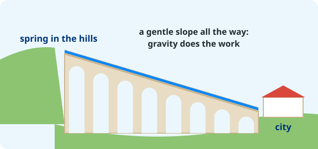

```{python}
import sys; sys.path.append("scripts")
from vocab import load_unit, pick, card_grid
terms = load_unit(2)
```

## All roads lead to Rome

- Romans built tens of thousands of kilometers of stone-paved roads.
- Roads were straight where possible, with a curved top so rain ran off.
- A  could march fast, and traders and letters moved across the .

::: notes
"All roads lead to Rome" is still a saying in many languages, meaning "there are many ways to reach the same goal". Ask: is there a similar saying in Chinese?
:::

## Water from the hills: the aqueduct

{fig-alt="An aqueduct bridge carrying water on a gentle downhill slope from a spring in the hills to a city"}

An  has **no pumps**. The channel slopes gently downhill the whole way, so gravity moves the water.

::: notes
The Pont du Gard in France carried water about 50 km to the city of Nîmes and still stands today. You'll design your own aqueduct on the challenge sheet.
:::

## Concrete and the Colosseum

:::: {.columns}
::: {.column width="45%"}
- Romans made strong concrete with volcanic ash.
- With it they built domes, harbors and arenas.
- The  held about 50,000 people.
- Crowds watched a  fight there.
:::
::: {.column width="55%"}
```{python}
#| output: asis
print(card_grid(pick(terms, "Colosseum", "gladiator"), zh=True))
```
:::
::::

## The forum

- Every Roman town had a : the main square.
- People shopped, heard news, went to court and worshipped there.
- In Rome, the senate met in a building on the Forum.

## Words and numbers

:::: {.columns}
::: {.column width="50%"}
**** became Italian, Spanish, French, Portuguese and Romanian. English borrowed thousands of Latin words:

- *aqua* (water) → **aquarium**, **aqueduct**
- *civis* (citizen) → **city**, **civil**
:::
::: {.column width="50%"}
****

| I | V | X | L | C | D | M |
|---|---|---|---|---|---|---|
| 1 | 5 | 10 | 50 | 100 | 500 | 1000 |

XII = 10 + 1 + 1 = **12** · IV = 5 − 1 = **4**
:::
::::

## Try it

::: {.poll type="choice" options="16 | 14 | 9" correct="B"}
What number is XIV?
:::

::: notes
X = 10, then IV = 4 (I before V subtracts), so 14.
:::

## The end of the western empire

- The  grew too big to defend and to run.
- In **AD 476**, the last emperor in the west was removed.
- The eastern half, with its capital at Constantinople, lasted almost 1,000 years more, until 1453.

## Exit ticket

::: {.poll type="smileys"}
How well can you explain how an aqueduct works?
:::
