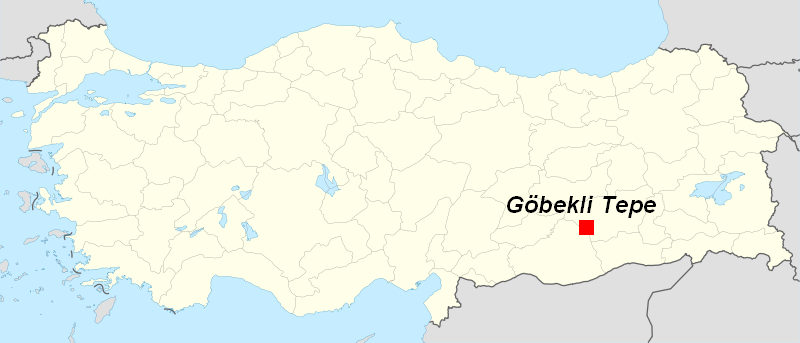
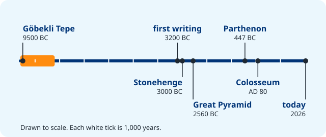
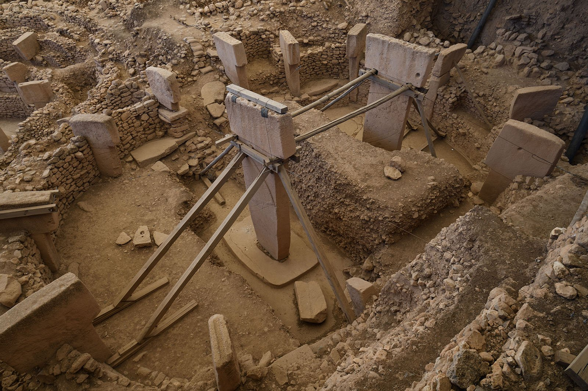
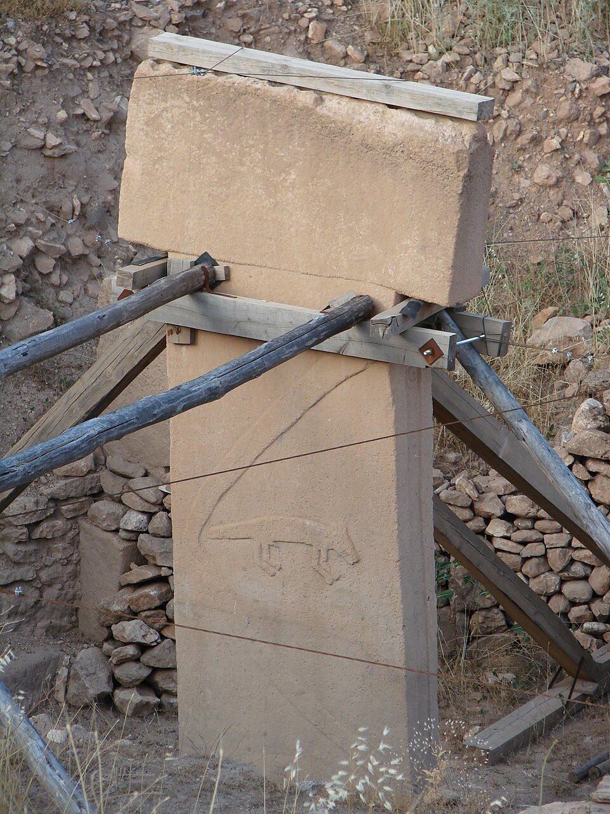
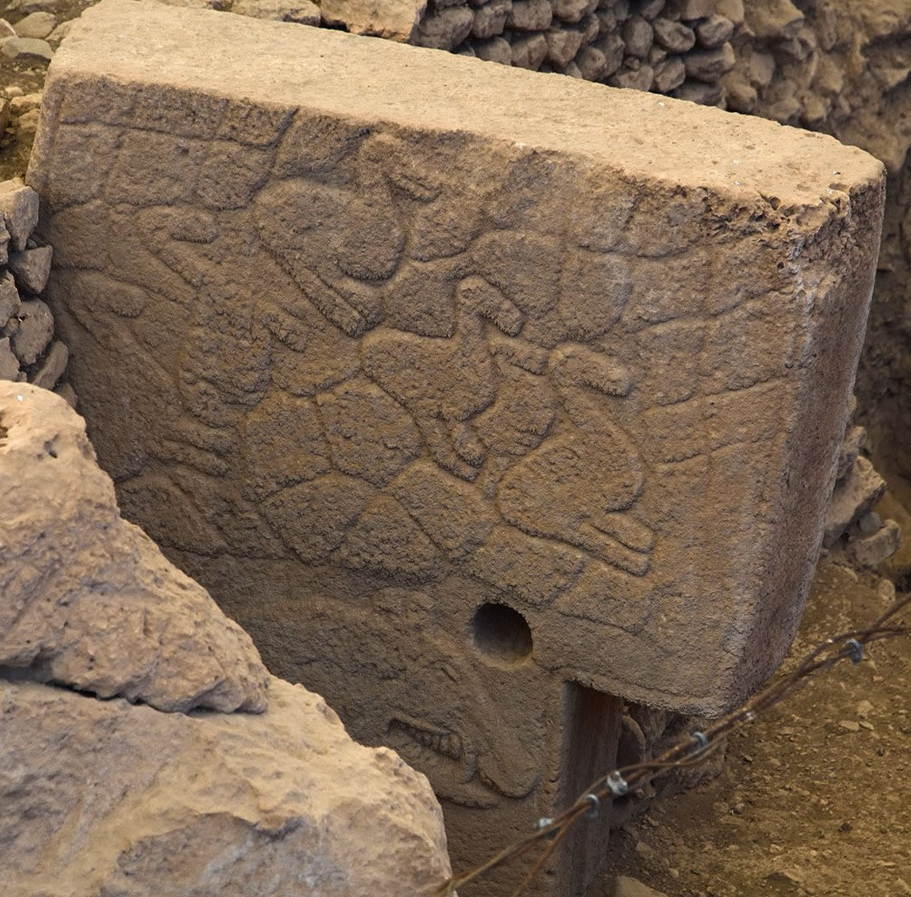

```{python}
import sys; sys.path.append("scripts")
from vocab import load_unit, pick, card_grid
terms = load_unit(3)
```

## Where is it?

:::: {.columns}
::: {.column width="55%"}
- On a hilltop in **south-east Turkey**, near the city of Şanlıurfa.
- The name is Turkish for **"Potbelly Hill"**: the hill is round, like a big belly.
- Under the hill are rings of giant carved stones.
:::
::: {.column width="45%"}
{.photo fig-alt="A map of Turkey with a red square in the south-east marking Göbekli Tepe"}

[Göbekli Tepe is in the south-east of Turkey, close to Syria.]{.photo-caption}
:::
::::

::: notes
Say it: *guh-bek-LEE TEH-peh*. Ask: what do we usually expect to find under a hill? (Rocks, soil. Sometimes, an old town.)
:::

## How old is it?

{fig-alt="A timeline drawn to scale from 9600 BC to today. Göbekli Tepe is at the far left, about 9500 BC. Writing, Stonehenge and the Great Pyramid come about 6,000 years later. The Parthenon and the Colosseum are near the right end."}

Göbekli Tepe was built about **11,500 years ago**, around 9500 BC. It is the oldest big stone monument we know.

::: notes
The orange bar is the time Göbekli Tepe was in use: about 1,500 years. Point out the Parthenon (Unit 1) and the Colosseum (Unit 2): they are closer in time to us than to Göbekli Tepe. Göbekli Tepe is more than 6,000 years older than Stonehenge, and older than writing.
:::

## Found twice

- **1963:** a survey team saw broken stones on the hill. They thought it was an old graveyard.
- **1994:** the  Klaus Schmidt looked again. He saw the stones were the tops of giant pillars.
- **1995 to today:** German and Turkish teams run the . They have dug up only about **one tenth** of the hill.

::: notes
Lesson: an expert can look at the same thing and see something new. We'll see archaeologists change their minds again in part 2.
:::

## Digging into the past

```{python}
#| output: asis
print(card_grid(pick(terms, "archaeologist", "excavation", "artifact"), zh=True))
```

## The enclosures

:::: {.columns}
::: {.column width="45%"}
- Each  is a round stone building, 10 to 30 m across.
- A ring of pillars stands in the wall, with a stone bench.
- Two **giant pillars** stand in the middle.
- Four have been dug up. Scans show many more under the hill.
:::
::: {.column width="55%"}
{.photo fig-alt="An excavated round stone building with a ring of pillars and two tall T-shaped pillars in the middle, held up by wooden supports"}

[Enclosure D, under a modern roof. The wooden frames keep the pillars safe.]{.photo-caption}
:::
::::

## T-pillars are people

{fig-alt="A T-shaped pillar labeled head, arm, hands, belt, animal relief and body, next to a 1.7 m person. The pillar is up to 5.5 m tall."}

A  is a : the biggest are **5.5 m tall** and weigh about **10 tonnes**, as much as six or seven cars.

::: notes
The top of the T is a head seen from the side; the long part is the body. On some pillars you can see arms down the sides, hands that meet in front, and a belt. So each pillar is a giant stone person without a face. Who could they be? Ancestors? Spirits? Nobody knows for sure.
:::

## Look closely

:::: {.columns}
::: {.column width="40%"}
{.photo .tall fig-alt="A T-shaped stone pillar with a long carved arm on its side and a carved fox below it"}
:::
::: {.column width="60%"}
- Find the **arm**: a long line down the side of the pillar.
- Find the **animal**: a fox, ready to jump.
- The carvings are : the stone around them was cut away.

::: {.small-note}
The wood and wires hold the pillar up while archaeologists work.
:::
:::
::::

## A zoo in stone

:::: {.columns}
::: {.column width="50%"}
The carvings show **wild animals**, many of them dangerous:

- foxes, wild boars and snakes
- vultures, cranes and ducks
- wild cattle (aurochs), scorpions and spiders

There are **no farm animals**: no sheep, goats or cows.
:::
::: {.column width="50%"}
{.photo fig-alt="Animals carved in relief on the side of a large stone pillar"}

[Animals carved on a pillar in Enclosure C.]{.photo-caption}
:::
::::

::: notes
The fact cards printable has six of these animals. Ask: why carve dangerous animals and not food animals? Take ideas; there is no single right answer. Researchers still debate it.
:::

## True or false?

Guess first, then click to see each answer.

::: {.quiz-list}
Göbekli Tepe is older than the Egyptian pyramids. [True]{.fragment .reveal-answer .true}

The pillars were carved with metal tools. [False: stone tools]{.fragment .reveal-answer .false}

Most carvings show farm animals like sheep and cows. [False: wild animals]{.fragment .reveal-answer .false}

Archaeologists have dug up the whole hill. [False: about 1/10]{.fragment .reveal-answer .false}
:::

```{=html}
<style>
  .reveal .quiz-list p { display: flex; justify-content: space-between; align-items: center; gap: 1em;
                         margin: 0; padding: 0.4em 0.6em; border-bottom: 2px solid #e3e6ea; }
  .reveal .reveal-answer { flex: none; padding: 0.1em 0.8em; border-radius: 999px; font-weight: 700; color: #003477; }
  .reveal .reveal-answer.true { background: #d6f5e3; }
  .reveal .reveal-answer.false { background: #ffe0bd; }
</style>
```

::: notes
No metal tools existed yet: the carvers used flint, a hard stone that breaks with sharp edges. Metal tools came thousands of years later.
:::

## Exit ticket

::: {.poll type="choice" options="About 2,000 years | About 4,500 years | About 11,500 years" correct="C"}
About how old is Göbekli Tepe?
:::

## Picture credits {.credits}

- **Title:** Göbekli Tepe panorama, photo by Spica-Vega Photo Arts (Banu Nazikcan), [CC BY-SA 4.0](https://creativecommons.org/licenses/by-sa/4.0), via Wikimedia Commons.
- **Map:** by Bjoertvedt, [CC BY-SA 3.0](https://creativecommons.org/licenses/by-sa/3.0), via Wikimedia Commons.
- **Enclosure D** and **Enclosure C animals:** photos by Dosseman, [CC BY-SA 4.0](https://creativecommons.org/licenses/by-sa/4.0), via Wikimedia Commons.
- **Arm and fox pillar:** photo by Guérin Nicolas, [CC BY-SA 3.0](https://creativecommons.org/licenses/by-sa/3.0), via Wikimedia Commons.
- Drawings: original, made for this course. Full list: `images/CREDITS.md`.
