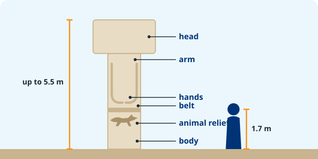

The builders of Göbekli Tepe carved each  to look like a person, with animals on it. Now design a pillar for **our class**.

{fig-alt="A T-shaped pillar labeled head, arm, hands, belt, animal relief and body, next to a 1.7 m person" width="80%"}

## 1. Plan

☐ Draw the **head** (the top of the T) and the **body**\
☐ Add **arms** down the sides and **hands** that meet in front\
☐ Add a **belt**\
☐ Add **two or three animals** as reliefs. Choose animals that say something about our class.

## 2. Draw your pillar

Draw the side view. Label: **head**, **body**, **arms**, **hands**, **belt** and each **animal**.





## 3. Explain

**a.** Which animals did you choose, and what do they say about our class?



**b.** You have no metal and no machines. How will you cut your pillar out of the ? (Think: flint, natural layers in the rock.)



**c.** Your pillar weighs 10 tonnes. How will you move it 500 m to the building, and how many people do you need?



::: {.content-visible when-profile="teacher"}
::: {.callout-note title="Answer key"}
**a.** Any animal with a reason. **b.** Cut grooves around the pillar shape with flint picks, down to a natural crack between rock layers, then lift it out with wooden beams and wedges. **c.** Ropes, wooden rollers or a sledge, a smooth or wet track, levers, ramps. Recent tests suggest about 7 to 14 people with ropes could move a pillar; accept any reasoned number.
:::
:::
