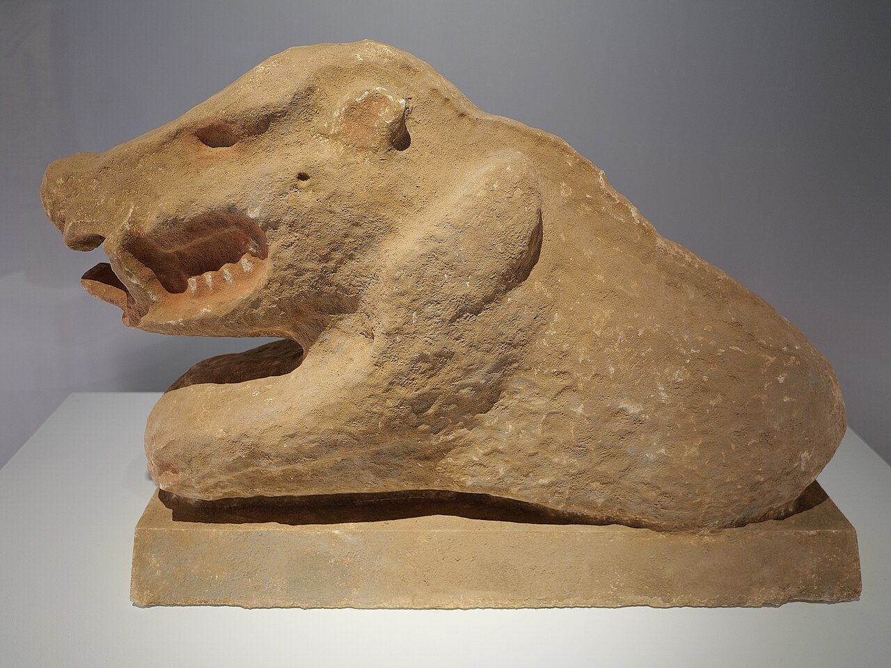
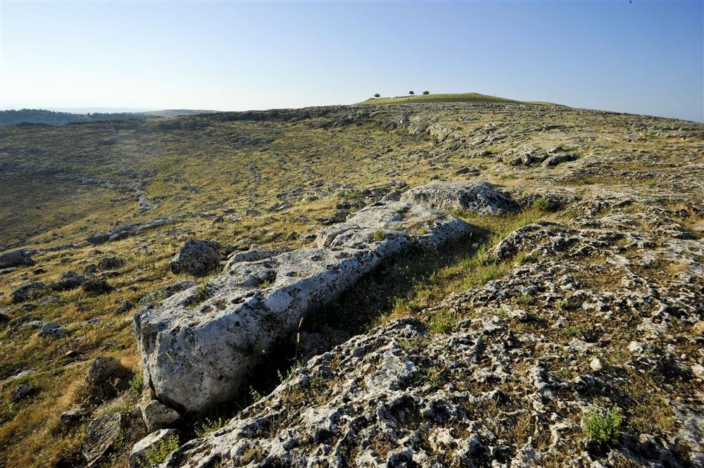

## The builders



::: notes
The builders had **no** farms, metal, writing or wheels. Ask: what would be hardest about building something huge without those?
:::

## What did they eat?

:::: {.columns}
::: {.column width="55%"}
- **Gazelle**, hunted in big numbers in late summer.
- Wild boar, wild cattle and birds.
- **Wild** wheat, barley, pistachios and almonds.
- They ground grain on stones: archaeologists found more than **7,000** grinding stones.
:::
::: {.column width="45%"}
{.photo fig-alt="A stone statue of a wild boar with an open mouth and sharp teeth"}

[A wild boar statue from Göbekli Tepe (a museum copy).]{.photo-caption}
:::
::::

::: notes
How do we know what they ate? Animal bones in the rubbish, and tiny bits of plants in the soil. That's evidence: more on that soon.
:::

## From the quarry

:::: {.columns}
::: {.column width="45%"}
1. The hill is limestone, in natural layers.
2. Workers cut a pillar shape into the rock with **flint** picks.
3. They lifted it out, probably with wooden beams.
4. They moved it a few hundred meters to the building.

One unfinished pillar, about 7 m long, still lies in the .
:::
::: {.column width="55%"}
{.photo fig-alt="A long stone pillar lying in rocky ground on a hilltop"}

[A pillar lying in the rock on the hilltop near the site.]{.photo-caption}
:::
::::

## How many people?

- **Old idea:** hundreds of workers were needed to move one pillar.
- **New tests:** about **7 to 14 people** with ropes could move a pillar.
- So a big family or a small village could have built a building in a few months.

## Think-pair-share

How would **you** move a 10-tonne stone, with no machines and no metal?



::: notes
Ideas to listen for: ropes, wooden rollers or sledges, wet ground or fat to make it slide, levers, lots of people pulling together, ramps of earth.
:::

## Evidence or guess?

:::: {.columns}
::: {.column width="50%"}
::: {.callout-tip title="Evidence 证据: what we found" icon=false}
- carved pillars and statues
- flint tools and grinding stones
- gazelle bones and burnt seeds
- channels and tanks for rainwater
:::
:::
::: {.column width="50%"}
::: {.callout-warning title="A guess: what it might mean" icon=false}
- "It was a temple."
- "The pillars are gods."
- "People came only for big feasts."
- "Nobody lived there."
:::
:::
::::

 is something we can see and check. A guess is an idea about what the evidence means.

## Archaeologists changed their minds

:::: {.columns}
::: {.column width="50%"}
::: {.callout-note title="The first idea (1990s)" icon=false}
**"The world's first temple."** People lived far away. They came to the hill only to build, feast and worship.
:::
:::
::: {.column width="50%"}
::: {.callout-tip title="Newer evidence (2010s)" icon=false}
- remains of **houses**
- **rainwater tanks** holding at least 150,000 liters
- thousands of tools for **cooking and grinding** food
:::
:::
::::

**Today:** people probably lived there **and** met there for special events. The team no longer calls it a "temple".

::: notes
This is how science works: new evidence changes the best explanation. The project leader, Lee Clare, says "temple" is a problem word: it suggests gods and priests, and there is no evidence of either. UNESCO calls the buildings "monumental communal buildings" used for social events and rituals.
:::

## Did it start farming?

- **Old idea:** building Göbekli Tepe pushed people to start farming, to feed all the workers.
- **Evidence:** all the grain and animals at the site were **wild**.
- But the world's first wheat farms grew in this same region, not long after.
- So the link is still an open question.

## Not the only one

- Archaeologists have found **more T-pillar sites** in the hills around Şanlıurfa, like Karahan Tepe and Nevalı Çori.
- Together they are called **Taş Tepeler**, Turkish for "Stone Hills".
- In 2018, Göbekli Tepe became a **UNESCO World Heritage Site**.

::: notes
UNESCO's description: "one of the first manifestations of human-made monumental architecture". Göbekli Tepe was part of a network of related communities, not a lonely wonder.
:::

## Exit ticket

::: {.poll type="choice" options="Archaeologists found more than 7,000 grinding stones. | Göbekli Tepe was a temple for gods. | The pillars show the builders' kings." correct="A"}
Which one is **evidence**, not a guess?
:::

## Picture credits {.credits}

- **Title:** the main excavation area from above, photo by E. Kücük, German Archaeological Institute, [CC BY 4.0](https://creativecommons.org/licenses/by/4.0), via Wikimedia Commons.
- **Wild boar statue:** photo by Bautsch, CC0, via Wikimedia Commons.
- **Unfinished pillar:** photo by Pouazity3, [CC BY-SA 4.0](https://creativecommons.org/licenses/by-sa/4.0), via Wikimedia Commons.
- Drawings: original, made for this course. Full list: `images/CREDITS.md`.
